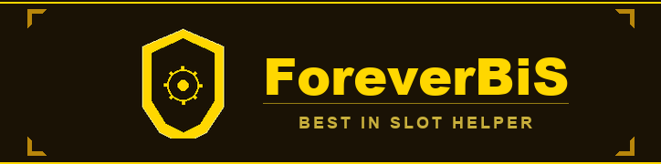

<p align="center">
  
</p>

<p align="center">
  A free, open-source addon for <b>World of Warcraft: Forever</b>: the ForeverChanges Best in Slot lists in the game, ranked per slot, with where every item comes from and how close you are to your set.
</p>

<p align="center">
  <a href="https://www.curseforge.com/wow/addons/foreverbis-helper"></a>
  <a href="https://github.com/Fragudev/addon-bis-forever/releases"></a>
</p>

<p align="center">
  <a href="LICENSE.md"></a>
  
  <a href="https://github.com/Fragudev/addon-bis-forever/releases"></a>
  <a href="https://github.com/Fragudev/addon-bis-forever/actions/workflows/ci.yml"></a>
</p>

<p align="center">
  <a href="#quick-start">Quick start</a> ·
  <a href="#what-it-is">What it is</a> ·
  <a href="#features">Features</a> ·
  <a href="#slash-commands">Slash commands</a> ·
  <a href="#how-the-lists-stay-current">How the lists stay current</a> ·
  <a href="#building-from-source">Building from source</a> ·
  <a href="#contributing">Contributing</a> ·
  <a href="#data-and-licensing">Data and licensing</a>
</p>

<table align="center">
  <tr>
    <td align="center" width="300"><a href="#quick-start"><b>Play</b></a><br>Install the addon and open it with <code>/bis</code>.</td>
    <td align="center" width="300"><a href="#building-from-source"><b>Work on Forever BiS</b></a><br>Run the tests, refresh the lists, build the zip.</td>
  </tr>
</table>

## Quick start

1. **Install it with the CurseForge app**: select your World of Warcraft: Forever profile, search for
   [ForeverBiS](https://www.curseforge.com/wow/addons/foreverbis-helper) and click **Install**, then skip to step 3.
   **Or download** the zip from [CurseForge](https://www.curseforge.com/wow/addons/foreverbis-helper) or the newest
   release on the [Releases page](https://github.com/Fragudev/addon-bis-forever/releases), under *Assets* (not
   "Source code").
2. **Unzip it into the game's AddOns folder**, so the `ForeverBiS` folder sits directly inside it:

   ```
   World of Warcraft\_classic_beta_\Interface\AddOns
   ```

3. **Restart the game completely** (a `/reload` does not load a new addon), check that `ForeverBiS` is enabled in the
   AddOns list on the character selection screen, and log in.
4. **Open the window** with `/bis`, `/foreverbis` or the minimap button. Your class is already selected; pick PvE or
   PvP and your build.

Good to know:

- **Updating:** the CurseForge app updates it for you. For a manual install, delete the old `ForeverBiS` folder and
  unzip the new release the same way.
- The lists ship inside the addon (WoW addons cannot make web requests), so new lists arrive as addon updates.
- The interface reads in English and Spanish (Spain), following the game client's language.

## What it is

Forever BiS brings the [ForeverChanges](https://foreverchanges.pro) Best in Slot lists into the game. For every
class, mode (PvE or PvP) and build it shows the ranked items for each slot, the list that matches your character's
level, where each item drops or comes from, and which ones you already have equipped or in your bags.

Around the window it adds BiS lines on every item tooltip, an alert when a BiS item drops in your group, a notice when
you enter a dungeon with items for your build, and commands to share a slot's list in chat.

> [!NOTE]
> **Beta.** The lists, classes and builds are the ones published on ForeverChanges; the addon only shows them and
> does not rank items on its own.

## Features

### The list

- **Class, mode and build.** Pick a class, a mode (`PvE` or `PvP`) and a build. The build dropdown lists the specs of
  the chosen mode by name (`Holy`, `Retribution`), and switching mode keeps the same spec when the other mode has it.
  The mode and build dropdowns hide when there is nothing to choose. Your selection is saved between sessions.
- **Your class on login.** The addon selects your character's class until you pick one yourself. Builds are never
  detected, so choose yours from the build dropdown.
- **Phases by level.** When a build has lists for more than one phase, a phase dropdown appears: `Auto` shows the
  list for your level (the lowest phase at or above it, or the latest once you pass them all), and you can pin any
  other phase to plan ahead. It stays hidden while a build has a single phase.
- **Ranked rows.** Each row shows its rank, an icon with a rarity-colored border, the item name in its rarity color
  and its source; boss or source names and their locations use separate colors, and drop rates omit the redundant
  Classic label. Use the arrow beside a slot heading to collapse or expand it.
- **What you own.** A green check marks items equipped in that slot, and an amber `xN` marks copies in your bags.
- **Faction items** show a faction emblem and a red Horde or blue Alliance label.

### Filters

- **Search** matches the item name, boss or zone; the close icon clears it.
- **Source buttons** (quest, dungeon or raid, world, profession) filter by source and combine; the dungeon picker
  appears while the dungeon button is active.
- **Faction button** shows your faction only (click it for both). It hides when the client does not report a faction.
- **Maker button** cycles through `Maker: all`, `Maker: only` (profession items only their maker can wear) and
  `Maker: hide`. Tradeable crafted items count as regular items.
- A counter shows `shown/total` while a filter hides items, the empty state offers `Clear filters`, and active
  filters show a lighter button with blue text and a blue underline.

### Paper doll and progress

- **Paper doll.** The right-side panel arranges item icons around a static render of your character. Each icon's
  border matches its rarity, turns red when the slot still lacks its BiS item and blue while hovered. The three weapon
  slots sit together below the character. Click a BiS icon to jump to its slot in the list.
- **Equipped Only** filters the panel to BiS-ranked items already equipped in their matching slots, including the
  right first or second ring and trinket slot.
- **Progress line.** `BiS 3/17`, with a thin blue bar that turns green when the list is complete, counts the tracked
  slots of the selected build and phase that hold their BiS item. A slot counts when its top-ranked item is equipped;
  rings and trinkets need the top two items in either order. Weapon variants (one-hand, two-hand, shield, held item)
  share one position each, and enchants are not counted. The line hides when the list has no trackable slots.
- **What to get next.** Hover the progress line for the build and phase, the BiS and `Listed` (at least one listed
  item equipped) totals, and up to eight slots with the next item and where it comes from. Items already in your bags
  are prefixed with `Equip:`, and `+N more` marks a truncated list.

### Tooltips

- **BiS on every item tooltip.** Bags, equipped gear, links, vendors, the auction house and comparison tooltips get a
  gold `Forever BiS` block listing where the item is BiS for your class, such as
  `BiS #2 Head - Feral PvE (Level 30)`.
- Each build shows the phase that matches your level, independent of the phase picked in the window; an item that is
  BiS only in another phase still appears, with that phase named. At most four lines are shown, then `+N more`.
- The addon's own window keeps its source and ownership tooltips without this block.

### In a group

- **Loot alerts.** When you or anyone in your group receives an item that is BiS for your selected build and phase, a
  highlighted chat message (rank, slot, build and phase) prints and a short sound plays. Each drop alerts once; items
  outside your build stay silent.
- **Dungeon notice.** Entering a dungeon or raid with items for your build shows a small notice with the count
  (`5 BiS items in The Deadmines`). Click it to open the window with the dungeon filter applied.
- **Sharing in chat.** Post a slot's ranked items, or the top item of every slot, with clickable links (see
  [Slash commands](#slash-commands)). Messages go to raid or party chat, or to say when you are alone, split under the
  chat limit. Shift-click an item icon in the list to put its link in the chat box.

### The window

- It opens at its minimum size, which keeps the BiS panel visible, and grows vertically from its bottom edge; a list
  taller than the window scrolls.
- The help icon on the selector row explains every feature: hover to read it or click to keep it open.
- Drag the minimap button around the minimap to reposition it.

## Slash commands

`/bis` (or `/foreverbis`) shows or hides the window. Toggles are account-wide and on by default.

| Command | What it does |
|---|---|
| `/bis` | Show or hide the window |
| `/bis link <slot>` | Post the ranked BiS items for a slot (a slot name or its first letters, such as `main hand` or `off`); an unknown slot prints the valid ones |
| `/bis link` | Post the top item of every slot |
| `/bis tooltip` | Turn the tooltip block on or off |
| `/bis tooltip all` | Show every class in the tooltip block instead of only yours |
| `/bis alerts` | Turn loot alerts on or off |
| `/bis dungeon` | Turn the dungeon notice on or off |

## How the lists stay current

The addon reads its bundled `ForeverBiS_Data.lua` (schema 2: lists per phase with structured item sources, see
[docs/data-schema-v2.md](docs/data-schema-v2.md)). Players never run anything: they install or update the addon.

1. Every six hours the [Update BiS lists](.github/workflows/update-lists.yml) workflow runs
   `UpdateForeverBiS.py`, which discovers the class and build pages on ForeverChanges and rewrites the data file.
2. The updater derives each list's phase from its title (for example "at level 30"). If it cannot download or parse
   every discovered page, it leaves the previous data file untouched.
3. When the lists changed, the workflow bumps the version in `ForeverBiS.toc`, tags it and publishes the release to
   GitHub and CurseForge.

## Building from source

This part is for working on Forever BiS itself; players need only the [Quick start](#quick-start).

You need Lua 5.1 with LuaRocks (`luacheck`, `busted`, `luacov`), [StyLua](https://github.com/JohnnyMorganz/StyLua)
2.5.2 and Python 3.

```sh
luacheck ForeverBiS tests                        # lint, including the layering rule
busted --coverage && luacov                      # the Lua test suite, with coverage
tools/check_coverage.sh 80                       # fail under 80% line coverage
stylua --check ForeverBiS tests                  # formatting
python3 -m unittest discover -s tests/python -v  # the updater's tests
python3 UpdateForeverBiS.py ForeverBiS           # refresh the lists from ForeverChanges
tools/package.sh <version>                       # build and verify Forever-<version>.zip
python3 tools/generate_minimap_icon.py           # regenerate the minimap icon artwork
```

[CI](.github/workflows/ci.yml) runs all of these on every pull request and every push to `main`. The version lives
only in `ForeverBiS.toc`; CI fails if the README hardcodes it.

### Project layout

| Path | What lives there |
|---|---|
| [`ForeverBiS/ForeverBiS.lua`](ForeverBiS/ForeverBiS.lua) | The composition root: creates the panels and defines `ns.requestRender()` |
| [`ForeverBiS/Core`](ForeverBiS/Core) | Pure logic: Settings, Catalog, Sources, Filters, Lists, Share, Loot |
| [`ForeverBiS/Adapters`](ForeverBiS/Adapters) | The only callers of the item, inventory and unit APIs: Items, Inventory, Player |
| [`ForeverBiS/UI`](ForeverBiS/UI) | Drawing only: Theme, Pixel, Skin, Dropdown (the look) and the panels |
| [`ForeverBiS/App`](ForeverBiS/App) | Client events and slash commands |
| `ForeverBiS/ForeverBiS_Data.lua` | The lists, generated by `UpdateForeverBiS.py` (never edited by hand) |
| `ForeverBiS/ForeverBiS_Locale.lua` | Translations; English strings are the keys |
| [`tests`](tests) | busted specs, WoW API stubs and the updater's Python tests |
| [`tools`](tools) | Packaging, coverage check, icon generator |
| [`docs`](docs) | Data schema and the visual design plan |
| [`CurseForge`](CurseForge) | The CurseForge page: description, changelog, banner, logo |

**Layering rule: Core never touches frames or the WoW API; Adapters are the only callers of the item, inventory and
unit APIs; UI only draws; App wires everything.**

- Every file starts with `local _, ns = ...` and shares the private namespace `ns`. The only globals are the saved
  variables, the data and the legacy `ForeverBiSModel` kept for compatibility.
- `Core/Settings.lua` is the only file that reads or writes the saved variables.
- UI panels never call each other. They share state through Core (for example `Filters.state`) and ask for a redraw
  with `ns.requestRender()`; its options are `scrollTop` and `jumpTo`.
- A new slash command is one entry in `Commands.handlers` in `App/Commands.lua`.
- Panels take colors, fonts and metrics from `UI/Theme.lua`, `UI/Pixel.lua`, `UI/Skin.lua` and `UI/Dropdown.lua`
  instead of hard-coding them; the design is in [docs/REDESIGN_PLAN.md](docs/REDESIGN_PLAN.md).

`.luacheckrc` enforces the rule: a file that uses an API outside its layer fails `luacheck` as an undefined variable.
To add a file, list it in `ForeverBiS.toc` (specs load files from the `.toc`, so the test stubs need no change).

## Contributing

Issues and pull requests are welcome on [GitHub](https://github.com/Fragudev/addon-bis-forever/issues).

- **Wrong item or source?** The lists come from ForeverChanges, so a wrong ranking belongs there. A wrong source,
  icon or tooltip in the addon is a bug here: open an issue with the class, build, phase and item.
- **Code** follows the layering rule above; keep `luacheck`, `busted` and the coverage check green.
- **Pull request titles** use [Conventional Commits](https://www.conventionalcommits.org/) (`feat:`, `fix:`,
  `chore:`); CI checks them.

## Data and licensing

Copyright (c) 2026 Fragudev. Forever BiS is licensed under the [MIT License](LICENSE.md). Third-party materials, game
assets and the Best in Slot list information from ForeverChanges are not claimed by this license.

The interface uses the [Fira Sans](https://github.com/mozilla/Fira) typeface (Regular, Medium and SemiBold), licensed
under the SIL Open Font License 1.1; the license text ships next to the fonts in `ForeverBiS/Media/Fonts/OFL.txt`. The
stroke icons in `ForeverBiS/Media/Icons/` and the minimap icon are original artwork.

<p align="center"><sub>World of Warcraft is a trademark of Blizzard Entertainment. Forever BiS is a community project, not affiliated with or endorsed by Blizzard or ForeverChanges.</sub></p>
