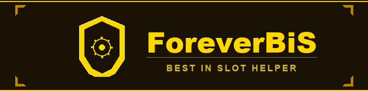

<p align="center">
  
</p>

<p align="center">
  A free addon for <b>World of Warcraft: Forever</b>: leveling Best in Slot lists for every class and spec, from level 20 to 60, in a gear grid, on every item tooltip and as a star on the items in your bags.
</p>

<p align="center">
  <a href="https://www.curseforge.com/wow/addons/foreverbis-helper"></a>
  <a href="https://github.com/Fragudev/addon-bis-forever/releases"></a>
</p>

<p align="center">
  <a href="LICENSE"></a>
  
  <a href="https://github.com/Fragudev/addon-bis-forever/releases"></a>
  <a href="https://github.com/Fragudev/addon-bis-forever/actions/workflows/ci.yml"></a>
</p>

<p align="center">
  <a href="#quick-start">Quick start</a> ·
  <a href="#what-it-is">What it is</a> ·
  <a href="#features">Features</a> ·
  <a href="#slash-commands">Slash commands</a> ·
  <a href="#how-the-lists-stay-current">How the lists stay current</a> ·
  <a href="#building-from-source">Building from source</a> ·
  <a href="#contributing">Contributing</a> ·
  <a href="#data-and-licensing">Data and licensing</a>
</p>

<table align="center">
  <tr>
    <td align="center" width="300"><a href="#quick-start"><b>Play</b></a><br>Install the addon and open it with <code>/bis</code>.</td>
    <td align="center" width="300"><a href="#building-from-source"><b>Work on Forever BiS</b></a><br>Run the tests, refresh the lists, build the zip.</td>
  </tr>
</table>

## Quick start

1. **Install it with the CurseForge app**: select your World of Warcraft: Forever profile, search for
   [ForeverBiS](https://www.curseforge.com/wow/addons/foreverbis-helper) and click **Install**, then skip to step 3.
   **Or download** the zip from [CurseForge](https://www.curseforge.com/wow/addons/foreverbis-helper) or the newest
   release on the [Releases page](https://github.com/Fragudev/addon-bis-forever/releases), under *Assets* (not
   "Source code").
2. **Unzip it into the game's AddOns folder**, so the `ForeverBiS` folder sits directly inside it:

   ```
   World of Warcraft\_classic_beta_\Interface\AddOns
   ```

3. **Restart the game completely** (a `/reload` does not load a new addon), check that `ForeverBiS` is enabled in the
   AddOns list on the character selection screen, and log in.
4. **Open the window** with `/bis`, `/foreverbis` or the minimap button. Your class, the spec your talents point to and
   the bracket for your level are already selected.

Good to know:

- **Updating:** the CurseForge app updates it for you; every refresh of the lists ships as a new release. For a manual
  install, delete the old `ForeverBiS` folder and unzip the new release the same way.
- The lists ship inside the addon (WoW addons cannot make web requests), so new lists arrive as addon updates.
- The interface reads in English and Spanish (Spain), following the game client's language.

## What it is

Forever BiS brings leveling Best in Slot lists into the game. The lists are generated by the addon's updater from the
item database and stat weights of [wowsims](https://github.com/wowsims/forever): for every class and its 26 PvE specs,
and for levels 20, 30, 40, 50 and 60 (pre-raid), it ranks the items the spec can use by their stats. Drop chances
come from the loot data of [EG Link](https://github.com/JIVESCORP/eg-link-output-wowf).

You see the lists in three places: a window with the top six items of every gear slot, a block on every item tooltip,
and a star on BiS items in your bags, the loot window and quest rewards. Around them it adds an alert when a BiS item
drops in your group, a notice when you enter a dungeon with items for your spec, and commands to share a slot's list
in chat.

> [!NOTE]
> The lists are computed from item stats and stat weights, not copied from a guide, so they rank items by their stats
> alone. The lists are PvE only.

## Features

### The lists

- **Generated per spec and bracket.** One list per spec and level bracket (20, 30, 40, 50 and 60 pre-raid), with the
  top six items per slot (two distinct rings and two distinct trinkets).
- **Where it comes from.** Each item keeps its source: the boss and dungeon, quest, vendor, profession or reputation.
  A crafted item names the profession that makes it (`Crafted by: Tailoring`), also when it drops somewhere too.
  Items the wowsims database gives no source for show `Source not listed by wowsims`.
- **Drop chances.** Where EG Link players have looted an item from the NPC its source names (at least 10 observed
  kills), the source shows its drop chance.

### The BiS window

- **Class, spec and bracket.** Three dropdowns pick the list. On first open the window selects your class and the spec
  of the talent tree with the most points; a class or spec you pick yourself is remembered per character. The bracket
  follows your level (`Auto`: the highest bracket at or below it) until you pick one.
- **Top 1 to Top 6.** One row per gear slot with its six best items as icons, ranked from left to right.
- **Equipped items** get a green border. Hover an icon for the item tooltip, with its source; shift-click it to link it
  in chat.
- **Inspect.** Inspect a player and click **BiS** on the inspect window: the BiS window opens on their class, the spec
  their talents point to and the bracket for their level, and the items they wear get a blue border. Closing the
  window returns to your own list.
- The help icon explains the window, and drag the minimap button around the minimap to reposition it.

### Tooltips

Every item tooltip (bags, equipped gear, links, vendors, the auction house and comparison tooltips) gets a gold
`Forever BiS` block with up to three parts:

- **Your spec:** the item's rank for your talent spec in the bracket of your level, or the brackets that list it, plus
  its source with the drop chance (`Crafted by: <profession>` for a crafted item); `Not BiS for <spec>` otherwise.
- **Your other specs:** the other specs of your class that list the item.
- **Other classes:** one row per other class, with its class icon, naming the specs and ranks.

Compact mode (on by default) shows two class rows; hold Shift to see them all. Each part and compact mode toggle with
`/bis tooltip` (see [Slash commands](#slash-commands)).

### BiS stars

Items in your bags, the loot window and quest rewards get a star when they are BiS in your current bracket: gold for
Top 1, silver for Top 2 to Top 6. The spec comes from your talents; without talent points every spec of your class
counts. `/bis stars` turns them off.

### In a group

- **Loot alerts.** When you or anyone in your group receives an item that is BiS for your spec and bracket, a
  highlighted chat message (rank, slot, spec and bracket) prints and a short sound plays. Each drop alerts once.
- **Dungeon notice.** Entering a dungeon or raid with items for your spec shows a small notice with the count
  (`5 BiS items in The Deadmines - click to view`). Click it to open the window.
- **Sharing in chat.** Post a slot's ranked items, or the top item of every slot, with clickable links. Messages go to
  raid or party chat, or to say when you are alone, split under the chat limit.

## Slash commands

`/bis` (or `/foreverbis`) shows or hides the window. Toggles are account-wide and on by default. The lists shared by
`/bis link` and the loot alerts follow the spec and bracket selected in the window.

| Command | What it does |
|---|---|
| `/bis` | Show or hide the window |
| `/bis link <slot>` | Post the ranked BiS items for a slot (a slot name or its first letters, such as `main hand` or `off`); an unknown slot prints the valid ones |
| `/bis link` | Post the top item of every slot |
| `/bis tooltip` | Turn the whole tooltip block on or off |
| `/bis tooltip spec` | Turn the line for your spec on or off |
| `/bis tooltip specs` | Turn the line for your other specs on or off |
| `/bis tooltip classes` | Turn the other-classes rows on or off (`/bis tooltip all` does the same) |
| `/bis tooltip compact` | Turn compact mode on or off (hold Shift for every row) |
| `/bis stars` | Show or hide the BiS stars on bag, loot and quest reward buttons |
| `/bis alerts` | Turn loot alerts on or off |
| `/bis dungeon` | Turn the dungeon notice on or off |
| `/bis minimap` | Show or hide the minimap button |

## How the lists stay current

The addon reads its bundled data file, `ForeverBiS_Data_Leveling.lua` (schema 3, see
[docs/data-schema-v3.md](docs/data-schema-v3.md)). Players never run anything: they install or update the addon.

1. Every six hours the [Update BiS lists](.github/workflows/update-lists.yml) workflow runs
   `UpdateForeverBiS.py`, which regenerates the leveling lists (`bis_sources/leveling.py`) from the current wowsims
   item database and stat weights and rewrites the data file. Drop chances come from the EG Link loot data of every live client build; if it cannot
   be downloaded, the lists are still written, without drop chances, and the run logs a warning.
2. The brackets are levels 20, 30, 40, 50 and 60 (pre-raid). If the wowsims data cannot be downloaded or
   parsed, the previous file is kept. A run that would lose a route the file already has also keeps the previous
   file. The workflow fails when the shipped source fails.
3. When any data file changed, the workflow commits it to `develop`, tags the next stable version (the latest
   `vX.Y.Z` with its patch bumped) and publishes it to GitHub and CurseForge as a release, so the CurseForge app offers
   the update to every player. `main` only takes reviewed pull requests, so the refreshed lists reach it with the next
   merge of `develop`.

Stable releases (`vX.Y.Z`) ship from `main` or `develop`, betas (`beta_X.Y.Z`) from `develop`; the release workflow
refuses a tag on any other branch. A `vX.Y.Z` tag writes `X.Y.Z` into the packaged `ForeverBiS.toc` (the repository
keeps the beta version), publishes the zip to GitHub as the latest release and uploads it to CurseForge as a release.
Betas are tagged by hand and published as prereleases.

A Kami Labs source is planned. It is not shipped until its site owner gives permission.

## Building from source

This part is for working on Forever BiS itself; players need only the [Quick start](#quick-start).

You need Lua 5.1 with LuaRocks (`luacheck`, `busted`, `luacov`), [StyLua](https://github.com/JohnnyMorganz/StyLua)
2.5.2 and Python 3.

```sh
luacheck ForeverBiS tests                        # lint, including the layering rule
busted --coverage && luacov                      # the Lua test suite, with coverage
tools/check_coverage.sh 80                       # fail under 80% line coverage
stylua --check ForeverBiS tests                  # formatting
python3 -m unittest discover -s tests/python -v  # the updater's tests
python3 UpdateForeverBiS.py ForeverBiS           # regenerate the leveling lists from wowsims
tools/package.sh <version>                       # build and verify Forever-<version>.zip
python3 tools/generate_minimap_icon.py           # regenerate the minimap icon artwork
```

[CI](.github/workflows/ci.yml) runs all of these on every pull request and every push to `main` or `develop`. The
version lives only in `ForeverBiS.toc`; CI fails if the README hardcodes it.

### Project layout

| Path | What lives there |
|---|---|
| [`ForeverBiS/ForeverBiS.lua`](ForeverBiS/ForeverBiS.lua) | The composition root: wires the panels and defines `ns.requestRender()` |
| [`ForeverBiS/Core`](ForeverBiS/Core) | Pure logic: Settings, Catalog, Sources, Lists, Share, Loot |
| [`ForeverBiS/Adapters`](ForeverBiS/Adapters) | The only callers of the item, inventory, unit, chat and zone APIs: Items, Inventory, Player, Chat, Zone |
| [`ForeverBiS/UI`](ForeverBiS/UI) | Drawing only: Theme, Pixel, Skin, Dropdown (the look), the window and its BiS grid, the inspect button, the BiS stars, the minimap button and the dungeon notice |
| [`ForeverBiS/App`](ForeverBiS/App) | Client events and slash commands |
| `ForeverBiS/ForeverBiS_Data_Leveling.lua` | The generated leveling lists, written by `UpdateForeverBiS.py` (never edited by hand) |
| [`bis_sources`](bis_sources) | The updater's source modules (leveling, Kami Labs), EG Link drop chances, item source text, the registry and shared helpers |
| `ForeverBiS/ForeverBiS_Tooltip.lua` | The BiS block on item tooltips |
| `ForeverBiS/ForeverBiS_Locale.lua` | Translations; English strings are the keys |
| [`tests`](tests) | busted specs, WoW API stubs and the updater's Python tests |
| [`tools`](tools) | Packaging, coverage check, icon generator |
| [`docs`](docs) | Data schema and the visual design plan |
| [`CurseForge`](CurseForge) | The CurseForge page: description, changelog, banner, logo |

**Layering rule: Core never touches frames or the WoW API; Adapters are the only callers of the item, inventory and
unit APIs; UI only draws; App wires everything.**

- Every file starts with `local _, ns = ...` and shares the private namespace `ns`. The only globals are the saved
  variables, the data and the legacy `ForeverBiSModel` kept for compatibility.
- `Core/Settings.lua` is the only file that reads or writes the saved variables.
- UI panels never call each other. They share state through Core (for example `Settings`) and ask for a redraw with
  `ns.requestRender()`, which redraws the selectors, the window and the BiS grid once.
- A new slash command is one entry in `Commands.handlers` in `App/Commands.lua`.
- Panels take colors, fonts and metrics from `UI/Theme.lua`, `UI/Pixel.lua`, `UI/Skin.lua` and `UI/Dropdown.lua`
  instead of hard-coding them; the design is in [docs/REDESIGN_PLAN.md](docs/REDESIGN_PLAN.md).

`.luacheckrc` enforces the rule: a file that uses an API outside its layer fails `luacheck` as an undefined variable.
To add a file, list it in `ForeverBiS.toc` (specs load files from the `.toc`, so the test stubs need no change).

## Contributing

Bug reports and ideas are welcome from everyone as issues; pull requests are open to maintainers only. See
[CONTRIBUTING.md](CONTRIBUTING.md) for what to include in a report and how maintainers work.

## Data and licensing

Copyright (c) 2026 Fragudev. Forever BiS is proprietary, all rights reserved: see [LICENSE](LICENSE). Third-party
materials, game assets, the wowsims data the lists are generated from and the EG Link drop chances are not claimed by
this license.

Credits: the items, stats, required levels, item sources and stat weights the lists are generated from come from
[wowsims/forever](https://github.com/wowsims/forever), licensed under the MIT License.

Drop chances come from the EG Link loot data in
[JIVESCORP/eg-link-output-wowf](https://github.com/JIVESCORP/eg-link-output-wowf), pooled across client builds and
rounded by the updater ([license](https://creativecommons.org/licenses/by/4.0/)):

Data from Efficient Games (https://efficient.games), licensed under CC BY 4.0.

The interface uses the [Fira Sans](https://github.com/mozilla/Fira) typeface (Regular, Medium and SemiBold), licensed
under the SIL Open Font License 1.1; the license text ships next to the fonts in `ForeverBiS/Media/Fonts/OFL.txt`. The
stroke icons in `ForeverBiS/Media/Icons/` and the minimap icon are original artwork.

<p align="center"><sub>World of Warcraft is a trademark of Blizzard Entertainment. Forever BiS is a community project, not affiliated with or endorsed by Blizzard or wowsims.</sub></p>
